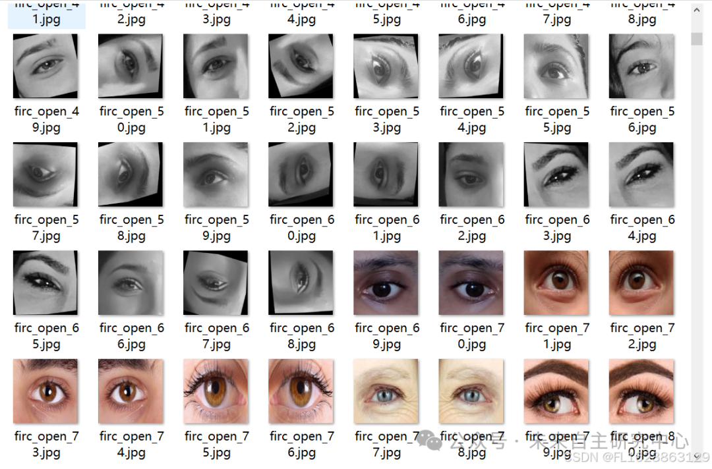

# [Dataset] Eye Closure and Opening Classification Dataset: 2361 Images in 2 Categories

Dataset Type: Image Classification, Not for Object Detection without labeled files
Dataset Format: Only contains jpg images, each category folder contains the corresponding image.
Number of Images (Total jpg files): 2362
Number of Categories: 2
Category Names: ["close", "open"]
Image Count per Category:
Close Images: 1159
Open Images: 1203

Important Notice: No
Special Declaration: This dataset does not guarantee the accuracy of the trained models or weight files, and only provides accurate and reasonable classification storage.

Image example:

## Payment

Here is a pay link on Stripe ( https://buy.stripe.com/3cs8yP7sY87d0vu9AB ). Please contact me lonlonago@foxmail.com after funding $89, and I will send you a complete data files , thank you!

